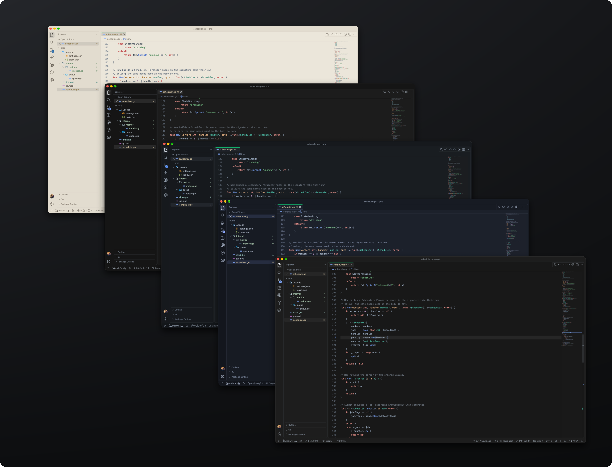
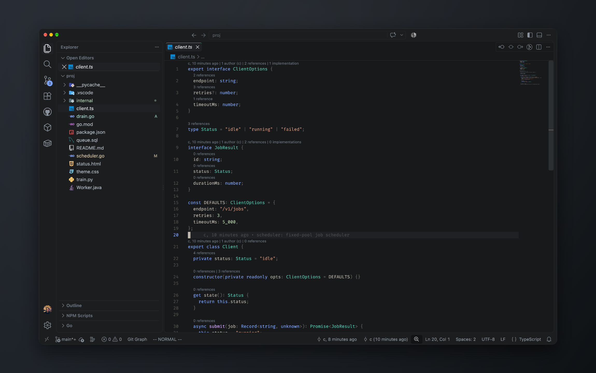
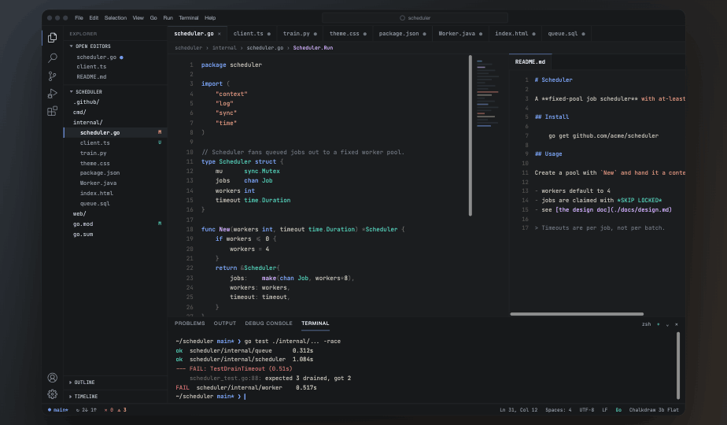
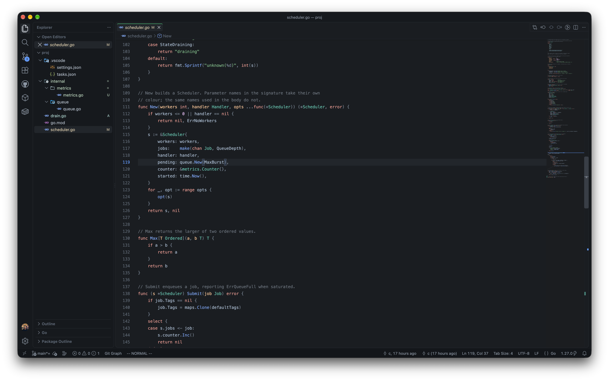
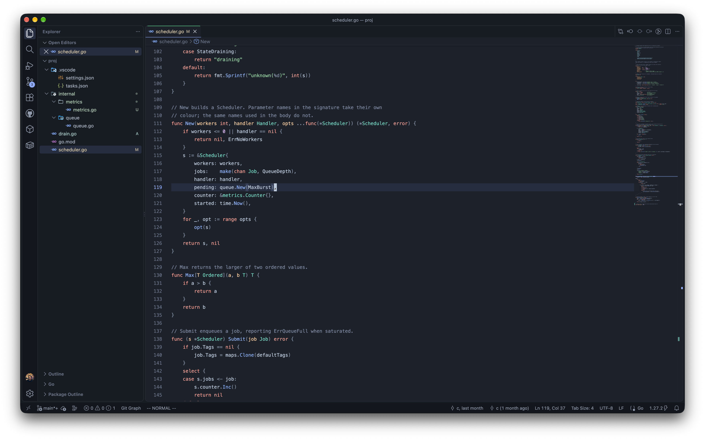
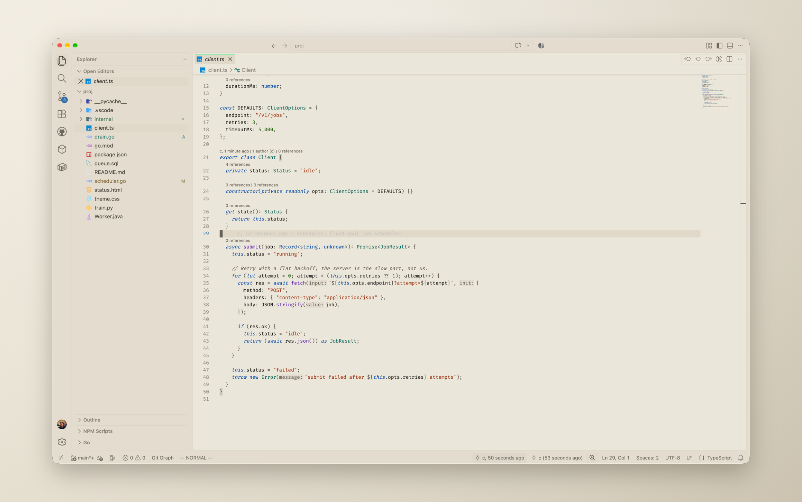

<div align="center">


# Chalkdraw

**A chalkboard-inspired theme**

[](https://marketplace.visualstudio.com/items?itemName=michaelvolakis.chalkdraw)
[](https://marketplace.visualstudio.com/items?itemName=michaelvolakis.chalkdraw)
[](https://marketplace.visualstudio.com/items?itemName=michaelvolakis.chalkdraw)
[](./LICENSE)

</div>

<br />



<br />

## Install

Open Quick Open (`Ctrl+P` / `Cmd+P`), then run:

```
ext install michaelvolakis.chalkdraw
```

Then pick the theme: **Preferences: Color Theme** → **Chalkdraw Deep**, **Chalkdraw Flat**, **Chalkdraw Cool**, **Chalkdraw Night** or **Chalkdraw Paper**.

<br />

## Neovim

The same five variants ship as a Neovim colorscheme, generated from the same palette source, so the two editors never drift apart. Requires Neovim 0.9+ with `termguicolors`.

**lazy.nvim**

```lua
{
  'mihavo/chalkdraw',
  lazy = false,
  priority = 1000,
  config = function()
    vim.cmd.colorscheme('chalkdraw-deep')
  end,
}
```

**packer**

```lua
use { 'mihavo/chalkdraw', config = function() vim.cmd.colorscheme('chalkdraw-deep') end }
```

**Transparent background**

```lua
{
  'mihavo/chalkdraw',
  lazy = false,
  priority = 1000,
  config = function()
    require('chalkdraw').setup({ variant = 'deep', transparent = true })
  end,
}
```
<br />

## iTerm2

Download the repo (or just the `iterm/` folder), then **iTerm2 → Settings → Profiles → Colors → Color Presets… → Import…** and pick the `.itermcolors` files. They appear in the same menu afterwards.

<br />


## Screenshots

**Deep**



**Flat**



**Cool**



**Night**



**Paper**



<br />

## Palette

| Role | Dark | Night | Paper |
| --- | --- | --- | --- |
| Keywords, storage, control flow | `#f29790` | `#ff9c94` | `#b7272d` |
| Imported module paths | `#98cddf` | `#9edcf2` | `#01535e` |
| Types, classes, packages | `#4fc9b0` | `#5ee2c6` | `#006d5c` |
| Functions and methods | `#7aa2f7` | `#8db2ff` | `#2c59c8` |
| Strings | `#75bf85` | `#8dd9a0` | `#29743f` |
| Numbers | `#e2b3ed` | `#eab9ff` | `#7c5186` |
| Named constants, enum members | `#d19b6c` | `#edaa72` | `#7c3e2e` |
| Variables, fields, properties | `#abbfd6` | `#bdcce0` | `#202e3e` |
| Parameter names in declarations | `#ffc491` | `#ffce9c` | `#985500` |
| Operators, brackets, separators | `#788696` | `#8592a8` | `#576474` |
| Comments | `#6d7681` | `#7f8aa4` | `#4e5d6f` |
| Line numbers | `#5e6976` | `#69738a` | `#798593` |
| Cursor | `#abbfd6` | `#bdcce0` | `#202e3e` |
| Rails, active marks | `#7aa2f7` | `#8ea9ff` | `#2e6da8` |
| Editor background | `#181818` | `#1c212b` | `#ebe6da` |
| Sidebar, tabs, status bar | `#1d1d1d` | `#171b23` | `#e2dcce` |
| Active line | `#262626` | `#252d40` | `#cfcabf` |
| Dividers | `#2d2f32` | `#171b23` | `#d9d3c7` |

The Dark column holds Deep's values. Flat and Cool share those inks over their own grounds. Night carries its own palette, and two of its surfaces sit lower than one row can show: the status bar and the activity bar drop to `#13161d`. Night's dividers take the chrome colour on purpose, so panels part by lightness rather than by a drawn line; its indent guides and rulers use `#282e3a`.

<br />

## Recommended settings

The screenshots above use these settings:

```jsonc
{
  "workbench.colorTheme": "Chalkdraw Deep",
  "editor.fontFamily": "JetBrains Mono, monospace",
  "editor.fontLigatures": false,
  "editor.fontSize": 13,
  "editor.lineHeight": 22,
  "editor.tabSize": 4,
  "editor.renderWhitespace": "selection"
}
```
